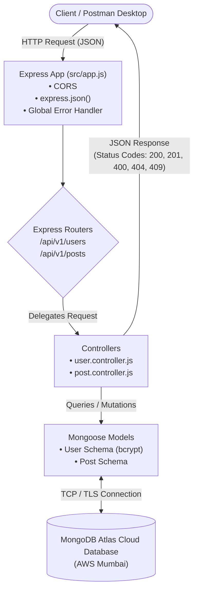
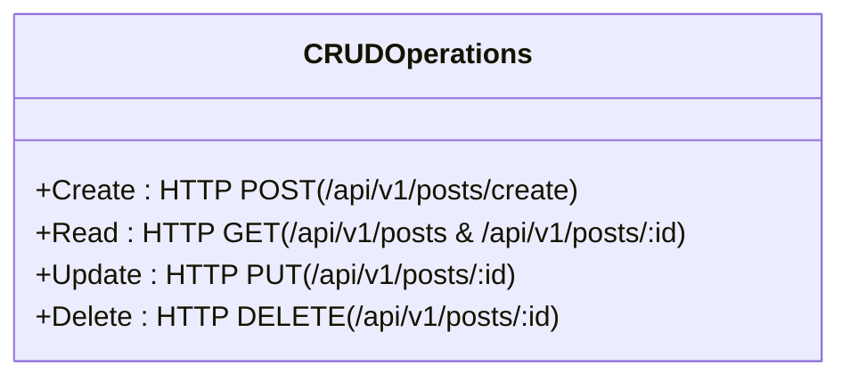

# Backend Development Assignment — Node.js, Express & MongoDB

A robust, production-structured RESTful backend service built with Node.js, Express.js, and MongoDB Atlas. This project implements secure user authentication (with password hashing), comprehensive CRUD operations for resources, centralized error handling, and end-to-end API testing workflows using Postman Desktop and automated integration test suites.

---

## Table of Contents

- [1. Project Overview](#1-project-overview)
- [2. Assignment Objective](#2-assignment-objective)
- [3. Tutorial Reference](#3-tutorial-reference)
- [4. Technology Stack](#4-technology-stack)
- [5. Prerequisites and Environment Setup](#5-prerequisites-and-environment-setup)
- [6. Project Folder Structure](#6-project-folder-structure)
- [7. Architecture and Request Flow](#7-architecture-and-request-flow)
- [8. MongoDB Atlas Configuration](#8-mongodb-atlas-configuration)
- [9. Database Models](#9-database-models)
- [10. API Endpoints](#10-api-endpoints)
- [11. API Request and Response Examples](#11-api-request-and-response-examples)
- [12. CRUD Operations Explained](#12-crud-operations-explained)
- [13. Postman Testing](#13-postman-testing)
- [14. Automated Integration Testing](#14-automated-integration-testing)
- [15. Error Handling and Validation](#15-error-handling-and-validation)
- [16. Security Practices](#16-security-practices)
- [17. Challenges and Solutions](#17-challenges-and-solutions)
- [18. How to Run the Project](#18-how-to-run-the-project)
- [19. Testing Results](#19-testing-results)
- [20. Learning Outcomes](#20-learning-outcomes)
- [21. Future Improvements](#21-future-improvements)
- [22. Repository Link](#22-repository-link)

---

## 1. Project Overview

This project is a university-level backend engineering submission demonstrating the design, implementation, and verification of a RESTful web service. Built using **Node.js** and **Express.js** as an ES Module (`"type": "module"`), the application interfaces with a cloud-hosted **MongoDB Atlas** database through the **Mongoose** Object Data Modeling (ODM) library.

The service provides:
- **Server Health Monitoring**: Real-time server and uptime verification.
- **User Authentication**: Secure user registration and login workflows featuring one-way cryptographic password hashing using `bcryptjs`.
- **Resource Management (Posts)**: Full Create, Read, Update, and Delete (CRUD) lifecycle for post documents with strict schema constraints and ID validations.
- **Production-Ready Hygiene**: Centralized asynchronous error handling, environmental secret isolation via `dotenv`, Cross-Origin Resource Sharing (`cors`), and Node.js native hot-reloading (`node --watch`).

---

## 2. Assignment Objective

The primary objective of this assignment is to demonstrate practical competency in foundational and intermediate backend software engineering concepts:
1. **RESTful Architecture**: Organizing endpoints logically, selecting proper HTTP verbs (`GET`, `POST`, `PUT`, `DELETE`), and adhering to uniform interface constraints.
2. **Database Modeling & Cloud Connectivity**: Establishing secure, persistent connections between an Express application and a remote MongoDB Atlas database cluster with schema validation and Mongoose lifecycle hooks.
3. **Cryptographic Security**: Safeguarding sensitive credentials using salt generation and bcrypt hashing, while strictly avoiding password hash leakage in API responses.
4. **Resilient Error Management**: Handling edge cases including malformed JSON payloads, invalid MongoDB `ObjectId` strings, duplicate unique records, and nonexistent resources.
5. **Rigorous Quality Assurance**: Verifying API contracts through structured Postman Desktop collections and automated integration unit tests.

---

## 3. Tutorial Reference

- **Reference Tutorial**: [YouTube Tutorial — Node.js, Express & MongoDB](https://www.youtube.com/watch?v=KOutPbKc9UM&t=2s)

### Verified Tutorial Scope vs. Extended Implementation

To ensure clarity for academic assessment, the table below outlines the core concepts derived from the tutorial and the professional architectural extensions engineered specifically for this assignment:

| Area | Tutorial Foundation | Extended Project Implementation |
| :--- | :--- | :--- |
| **Module System** | Standard CommonJS / basic ES imports | Clean ES Modules (`import/export`) configured via `"type": "module"` in `package.json` |
| **Server Architecture** | Monolithic single-file setup (`server.js`) | Decoupled Model-View-Controller (MVC) architecture (`src/index.js`, `src/app.js`, `routes/`, `controllers/`, `models/`, `db/`) |
| **Development Watcher** | Third-party `nodemon` daemon | Native Node.js watch mode (`node --watch src/index.js`), eliminating audit vulnerabilities |
| **Password Security** | Basic hashing concepts | Pre-save Mongoose middleware hooks and schema instance methods (`comparePassword`) via `bcryptjs` |
| **Validation & Safety** | Basic body attribute retrieval | Granular checks: `ObjectId.isValid()`, duplicate check (409 Conflict), type validation, and centralized error handler middleware |
| **API Testing** | Manual browser/curl checks | Versioned Postman Collection v2.1 with dynamic variable extraction and automated Node.js test suite (`npm test`) |

---

## 4. Technology Stack

- **Node.js (v24.21.0 / v24.14.0)**: Event-driven, asynchronous JavaScript runtime executing the server-side application.
- **Express.js (v5.3.0)**: Minimalist, flexible web application framework facilitating routing, middleware integration, and HTTP request/response pipelines.
- **MongoDB Atlas**: Managed multi-cloud database service hosting the NoSQL database cluster (AWS Mumbai region).
- **Mongoose (v9.11.4)**: Asynchronous ODM providing strict schema enforcement, data validation, and database abstraction.
- **bcryptjs (v3.0.3)**: Optimized JavaScript implementation of the bcrypt password-hashing algorithm for credential protection.
- **cors (v2.8.6)**: Express middleware enabling controlled Cross-Origin Resource Sharing headers.
- **dotenv (v18.0.9)**: Zero-dependency module that loads environment variables from a private `.env` file into `process.env`.
- **Git & GitHub**: Distributed version control system and remote repository hosting for source code lifecycle management.
- **Postman Desktop**: API client utilized to execute, validate, and document manual and automated integration test workflows.

---

## 5. Prerequisites and Environment Setup

This section documents the step-by-step preparation of the development environment.

### 1. Node.js and npm Installation
- Ensure Node.js (v18.x or higher; tested on v24.x) and npm (v9.x or higher; tested on v11.x) are installed:
  ```cmd
  :: Windows Command Prompt / PowerShell
  node -v
  npm -v
  ```

### 2. Git Installation
- Verify Git installation and configure basic identity:
  ```cmd
  git --version
  ```

### 3. Project Folder Creation
- Create and navigate into the project workspace:
  ```cmd
  :: Windows CMD / PowerShell
  mkdir backend-tutorial
  cd backend-tutorial
  ```

### 4. npm Initialization
- Initialize a new `package.json` package descriptor:
  ```cmd
  npm init -y
  ```

### 5. Package Installation
- Install core runtime dependencies:
  ```cmd
  npm install express mongoose dotenv cors bcryptjs
  ```

### 6. package.json Configuration with ES Modules
- Open `package.json` and declare `"type": "module"` to use native ES module `import`/`export` syntax:
  ```json
  {
    "type": "module"
  }
  ```

### 7. Native Node.js Watch Mode Instead of nodemon
- To avoid third-party security vulnerabilities found in legacy daemons (e.g., `minimatch` in `nodemon`), configure the `dev` script to use Node's native file watcher:
  ```json
  "scripts": {
    "start": "node src/index.js",
    "dev": "node --watch src/index.js",
    "test": "node --test tests/**/*.test.js"
  }
  ```

### 8. MongoDB Atlas Cluster Setup
- Sign up for a free MongoDB Atlas account.
- Deploy a free M0 cluster named `BackendCluster` hosted in the `AWS / Mumbai (ap-south-1)` region.

### 9. Database User and Network Access Configuration
- **Database Access**: Create a database user with password authentication and assign the built-in role `Read and write to any database`.
- **Network Access**: Add an IP access entry to the whitelist. For testing, add `0.0.0.0/0` (allow access from anywhere) or whitelist your current public IP address.

### 10. .env and .gitignore Configuration
- Create `.gitignore` to guarantee local environment secrets and `node_modules` are never tracked:
  ```gitignore
  node_modules/
  .env
  .env.*
  !.env.example
  ```
- Verify that `.env` is ignored by Git:
  ```cmd
  git check-ignore .env
  ```
  *(Returns `.env`, confirming successful exclusion)*
- Create a template file `.env.example` with placeholders only:
  ```env
  PORT=5000
  MONGODB_URI=mongodb+srv://<username>:<password>@backendcluster.xxxxxx.mongodb.net/backend-tutorial?retryWrites=true&w=majority
  ```

### 11. Postman Desktop Installation
- Download and install the Postman Desktop application from [postman.com/downloads](https://www.postman.com/downloads/) to perform manual API requests and automated assertions.

---

## 6. Project Folder Structure

```
backend-tutorial/
├── .env                                  # Local environment secrets (excluded from Git)
├── .env.example                          # Safe template showing required environment variables
├── .gitignore                            # Rules specifying files ignored by Git version control
├── package.json                          # Project metadata, dependencies, and scripts
├── package-lock.json                     # Deterministic dependency tree lockfile
├── README.md                             # Comprehensive project documentation
├── postman/
│   └── backend-tutorial.postman_collection.json # Postman v2.1 API test suite with assertions
├── src/
│   ├── app.js                            # Express app configuration, middleware, and route mounting
│   ├── index.js                          # Server entry point; handles DB connection and HTTP listen
│   ├── controllers/
│   │   ├── post.controller.js            # Post CRUD request handling and business logic
│   │   └── user.controller.js            # User registration and authentication controller
│   ├── db/
│   │   └── database.js                   # Mongoose connection logic to MongoDB Atlas
│   ├── models/
│   │   ├── post.model.js                 # Mongoose schema definition for Post collection
│   │   └── user.model.js                 # Mongoose schema definition and hooks for User collection
│   └── routes/
│       ├── post.route.js                 # REST routing declarations for /api/v1/posts
│       └── user.route.js                 # REST routing declarations for /api/v1/users
└── tests/
    └── app.test.js                       # Automated integration tests using node:test runner
```

### Directory Responsibilities
- **`src/db/`**: Isolates database connectivity logic, ensuring credentials are verified prior to HTTP socket binding.
- **`src/models/`**: Defines data structures, type constraints, default values, and schema hooks.
- **`src/controllers/`**: Encapsulates business logic, input validation, database queries, and response formatting.
- **`src/routes/`**: Maps HTTP request verbs and path patterns to controller actions.
- **`src/app.js`**: Pure Express application composition (middleware pipelines, routing, centralized error handlers).
- **`src/index.js`**: Infrastructure bootstrap layer that guarantees database availability before listening on a network port.

---

## 7. Architecture and Request Flow

The backend employs an architectural separation of concerns inspired by the **Model-View-Controller (MVC)** pattern (where the "View" is represented by JSON payloads consumed by client applications).



### Server Initialization and Connectivity
The initialization sequence in `src/index.js` guarantees that the server only accepts incoming requests after verifying database connectivity:
1. `dotenv.config()` loads environment variables into `process.env`.
2. `connectDB()` invokes `mongoose.connect(process.env.MONGODB_URI)`.
3. If connection succeeds, the connection host is logged and `app.listen(PORT)` binds to the network port.
4. If connection fails, a clear diagnostic message is logged and the process terminates (`process.exit(1)`) without exposing secrets.

---

## 8. MongoDB Atlas Configuration

MongoDB Atlas is used to provide a cloud-hosted, managed database.

### 1. Cluster Provisioning
1. Sign in to MongoDB Atlas and create a free-tier M0 cluster (`BackendCluster`) hosted in the `AWS / Mumbai (ap-south-1)` region.
2. Under **Database Access**:
   - Create a database user with password authentication.
   - Assign the built-in role **Read and write to any database**.
3. Under **Network Access**:
   - Add an IP Access List entry. For development flexibility, allow access from anywhere (`0.0.0.0/0`) or specify your current public IP address.

### 2. Environment Variable Configuration
Create a `.env` file in the project root (never commit this file to version control):

```env
# Server Port Configuration
PORT=5000

# MongoDB Atlas Connection URI
# Replace <username>, <password>, and <cluster-url> with your Atlas cluster details
MONGODB_URI=mongodb+srv://<username>:<password>@backendcluster.xxxxxx.mongodb.net/backend-tutorial?retryWrites=true&w=majority
```

---

## 9. Database Models

### 1. User Model (`src/models/user.model.js`)

| Field | Type | Validation Rules | Description |
| :--- | :--- | :--- | :--- |
| `username` | String | `required: true`, `unique: true`, `trim: true`, `lowercase: true`, `minlength: 3` | Unique user handle |
| `email` | String | `required: true`, `unique: true`, `trim: true`, `lowercase: true`, regex matched | Unique email address |
| `password` | String | `required: true`, `minlength: 6` | Stored exclusively as a bcrypt cryptographic hash |
| `createdAt` | Date | Managed by `{ timestamps: true }` | Record creation timestamp |
| `updatedAt` | Date | Managed by `{ timestamps: true }` | Record modification timestamp |

#### Password Hashing Architecture
Password security is enforced at the schema level using a Mongoose pre-save hook:
```javascript
userSchema.pre("save", async function () {
  if (!this.isModified("password")) return;
  const salt = await bcrypt.genSalt(10);
  this.password = await bcrypt.hash(this.password, salt);
});
```
Verification is performed using a schema instance method:
```javascript
userSchema.methods.comparePassword = async function (candidatePassword) {
  return await bcrypt.compare(candidatePassword, this.password);
};
```

---

### 2. Post Model (`src/models/post.model.js`)

| Field | Type | Validation Rules | Description |
| :--- | :--- | :--- | :--- |
| `name` | String | `required: [true, "Name is required"]`, `trim: true` | Title or author of the post |
| `description` | String | `required: [true, "Description is required"]`, `trim: true` | Body content of the post |
| `age` | Number | `required: [true, "Age is required"]`, `min: [0, "Age cannot be negative"]` | Age attribute associated with post |
| `createdAt` | Date | Managed by `{ timestamps: true }` | Record creation timestamp |
| `updatedAt` | Date | Managed by `{ timestamps: true }` | Record modification timestamp |

---

## 10. API Endpoints

All application routes are prefixed with `/api/v1`:

| # | Endpoint | HTTP Method | Purpose | Success Status | Error Status Codes |
| :---: | :--- | :---: | :--- | :---: | :---: |
| 1 | `/api/v1/health` | `GET` | Health check and server uptime monitoring | `200 OK` | `500 Internal Error` |
| 2 | `/api/v1/users/register` | `POST` | Register a new user account with hashed password | `201 Created` | `400 Bad Request`, `409 Conflict` |
| 3 | `/api/v1/users/login` | `POST` | Authenticate an existing user with email and password | `200 OK` | `400 Bad Request`, `401 Unauthorized` |
| 4 | `/api/v1/posts/create` | `POST` | Create a new post document | `201 Created` | `400 Bad Request` |
| 5 | `/api/v1/posts` | `GET` | Retrieve all posts (sorted descending by creation date) | `200 OK` | `500 Internal Error` |
| 6 | `/api/v1/posts/:id` | `GET` | Retrieve a single post by its MongoDB `_id` | `200 OK` | `400 Bad Request`, `404 Not Found` |
| 7 | `/api/v1/posts/:id` | `PUT` | Update post fields (`name`, `description`, `age`) | `200 OK` | `400 Bad Request`, `404 Not Found` |
| 8 | `/api/v1/posts/:id` | `DELETE` | Delete a post document by its MongoDB `_id` | `200 OK` | `400 Bad Request`, `404 Not Found` |

---

## 11. API Request and Response Examples

*(Note: All credentials, emails, and tokens displayed below are synthetic examples for testing purposes.)*

### 1. User Registration
- **Request**: `POST /api/v1/users/register`
```json
{
  "username": "alexkumar",
  "email": "alex.kumar@example.com",
  "password": "StrongPassword987"
}
```
- **Response** (`201 Created`):
```json
{
  "success": true,
  "message": "User registered successfully",
  "data": {
    "_id": "672688f9b1c2d3e4f5a6b7c8",
    "username": "alexkumar",
    "email": "alex.kumar@example.com",
    "createdAt": "2026-11-02T14:45:13.120Z",
    "updatedAt": "2026-11-02T14:45:13.120Z"
  }
}
```
*Note: The password hash is deliberately excluded from the JSON response.*

---

### 2. User Login
- **Request**: `POST /api/v1/users/login`
```json
{
  "email": "alex.kumar@example.com",
  "password": "StrongPassword987"
}
```
- **Response** (`200 OK`):
```json
{
  "success": true,
  "message": "Login successful",
  "data": {
    "_id": "672688f9b1c2d3e4f5a6b7c8",
    "username": "alexkumar",
    "email": "alex.kumar@example.com"
  }
}
```

---

### 3. Create Post
- **Request**: `POST /api/v1/posts/create`
```json
{
  "name": "Cloud Microservices Tutorial",
  "description": "An introduction to building scalable APIs using Express and MongoDB Atlas",
  "age": 23
}
```
- **Response** (`201 Created`):
```json
{
  "success": true,
  "message": "Post created successfully",
  "data": {
    "_id": "6726895db1c2d3e4f5a6b7c9",
    "name": "Cloud Microservices Tutorial",
    "description": "An introduction to building scalable APIs using Express and MongoDB Atlas",
    "age": 23,
    "createdAt": "2026-11-02T14:46:53.402Z",
    "updatedAt": "2026-11-02T14:46:53.402Z",
    "__v": 0
  }
}
```

---

### 4. Update Post
- **Request**: `PUT /api/v1/posts/6726895db1c2d3e4f5a6b7c9`
```json
{
  "name": "Advanced Cloud Microservices Tutorial",
  "description": "Revised edition featuring connection pooling and index optimizations",
  "age": 24
}
```
- **Response** (`200 OK`):
```json
{
  "success": true,
  "message": "Post updated successfully",
  "data": {
    "_id": "6726895db1c2d3e4f5a6b7c9",
    "name": "Advanced Cloud Microservices Tutorial",
    "description": "Revised edition featuring connection pooling and index optimizations",
    "age": 24,
    "createdAt": "2026-11-02T14:46:53.402Z",
    "updatedAt": "2026-11-02T14:48:21.890Z",
    "__v": 0
  }
}
```

### Document Identification in MongoDB
In MongoDB, each record is assigned an immutable 12-byte `_id` represented as a 24-character hexadecimal string. This key acts as the primary document identifier throughout the CRUD lifecycle, passed in the path parameter for retrieval, update, and deletion queries.

---

## 12. CRUD Operations Explained

CRUD encompasses the fundamental operations required to maintain persistent data in software applications:



1. **Create (`POST`)**: Submits new data to the server to instantiate a new record. Mongoose verifies schema constraints and persists the document into the MongoDB collection (`Post.create()`). Status code: `201 Created`.
2. **Read (`GET`)**: Retrieves representations of resources without altering server state. Mongoose queries the collection using `Post.find()` or `Post.findById(id)`. Status code: `200 OK`.
3. **Update (`PUT`)**: Modifies an existing record identified by its unique `_id`. Mongoose executes `Post.findByIdAndUpdate()` with `{ new: true, runValidators: true }` to return the updated document. Status code: `200 OK`.
4. **Delete (`DELETE`)**: Removes an existing record identified by its `_id`. Mongoose executes `Post.findByIdAndDelete()`. Status code: `200 OK`.

---

## 13. Postman Testing

A comprehensive Postman test suite is provided in the repository under:
`postman/backend-tutorial.postman_collection.json`

### Step-by-Step Testing Workflow
1. **Start the backend**:
   ```bash
   npm run dev
   ```
2. **Import Collection**:
   Open **Postman Desktop**, click **Import**, and choose `postman/backend-tutorial.postman_collection.json`.
3. **Set Base URL**:
   Ensure collection variable `baseUrl` is configured to `http://localhost:5000`.
4. **Test the health endpoint**:
   Execute `GET {{baseUrl}}/api/v1/health`. Expected status: **200 OK**.
5. **Register a user**:
   Execute `POST {{baseUrl}}/api/v1/users/register` with user payload. Expected status: **201 Created**.
6. **Login**:
   Execute `POST {{baseUrl}}/api/v1/users/login` with email and password. Expected status: **200 OK**.
7. **Create a post**:
   Execute `POST {{baseUrl}}/api/v1/posts/create`. Expected status: **201 Created** (test script captures `_id` into `postId`).
8. **Retrieve all posts**:
   Execute `GET {{baseUrl}}/api/v1/posts`. Expected status: **200 OK**.
9. **Retrieve one post**:
   Execute `GET {{baseUrl}}/api/v1/posts/{{postId}}`. Expected status: **200 OK**.
10. **Update the post**:
    Execute `PUT {{baseUrl}}/api/v1/posts/{{postId}}`. Expected status: **200 OK**.
11. **Delete the post**:
    Execute `DELETE {{baseUrl}}/api/v1/posts/{{postId}}`. Expected status: **200 OK**.
12. **Verify the deleted post returns 404**:
    Execute `GET {{baseUrl}}/api/v1/posts/{{postId}}`. Expected status: **404 Not Found**.

The user manually completed this complete API test sequence successfully in Postman Desktop.

### Expected Status Codes Summary
- Health Check: `200`
- Register: `201`
- Login: `200`
- Create Post: `201`
- Get All Posts: `200`
- Get Post by ID: `200`
- Update Post: `200`
- Delete Post: `200`
- Get Deleted Post: `404`

---

## 14. Automated Integration Testing

In addition to manual Postman verification, this repository includes an automated test suite executed via the native Node.js test runner (`node:test` and `node:assert/strict`).

```bash
# Execute automated test suite
npm test
```

### Verified Test Log Output
```
> backend-tutorial@1.0.0 test
> node --test tests/**/*.test.js

▶ Automated Backend API & Model Integration Tests
  ✔ GET /api/v1/health should return 200 OK and healthy status (13.57ms)
  ✔ GET / should return 200 OK and welcome message (1.60ms)
  ✔ GET /api/v1/undefined-route should return 404 Route not found (0.92ms)
  ✔ POST /api/v1/users/register should reject empty payload with 400 (10.63ms)
  ✔ POST /api/v1/users/register should reject short password with 400 (1.88ms)
  ✔ POST /api/v1/users/login should reject empty payload with 400 (1.06ms)
  ✔ POST /api/v1/posts/create should reject missing required fields with 400 (1.35ms)
  ✔ POST /api/v1/posts/create should reject negative or invalid age with 400 (1.41ms)
  ✔ GET /api/v1/posts/:id should return 400 for invalid ObjectId format (1.46ms)
  ✔ PUT /api/v1/posts/:id should return 400 for invalid ObjectId format (1.51ms)
  ✔ DELETE /api/v1/posts/:id should return 400 for invalid ObjectId format (0.90ms)
  ✔ User Model schema should enforce validation rules and bcrypt password hashing (176.24ms)
  ✔ Post Model schema should validate required fields and constraints (0.77ms)
✔ Automated Backend API & Model Integration Tests (215.69ms)

ℹ tests 13
ℹ suites 1
ℹ pass 13
ℹ fail 0
ℹ cancelled 0
ℹ skipped 0
ℹ todo 0
ℹ duration_ms 444.29ms
```

### Testing Scope Distinction
- **Automated Tests (`npm test`)**: Provide deterministic regression prevention, contract adherence, parameter boundary checking, schema validation, and synchronous password hashing verification without requiring active cloud network access.
- **Manual Postman Tests**: Validate full end-to-end cloud persistence, network latency, TLS handshakes with MongoDB Atlas, and client header negotiations.

---

## 15. Error Handling and Validation

The application utilizes structured error handling across controllers and a centralized Express error middleware (`src/app.js`):

| HTTP Status Code | Scenario | Trigger Condition | JSON Response Format |
| :---: | :--- | :--- | :--- |
| **`400 Bad Request`** | Missing required fields | `!name \|\| !description \|\| age === undefined` | `{"success": false, "message": "Please provide name, description, and age"}` |
| **`400 Bad Request`** | Invalid MongoDB `_id` | `!mongoose.Types.ObjectId.isValid(id)` | `{"success": false, "message": "Invalid post ID format"}` |
| **`400 Bad Request`** | Schema validation failure | Mongoose `ValidationError` (e.g. invalid email format) | `{"success": false, "message": "Validation Error", "errors": [...]}` |
| **`401 Unauthorized`** | Authentication failure | User not found or bcrypt comparison fails | `{"success": false, "message": "Invalid email or password"}` |
| **`404 Not Found`** | Resource missing | `Post.findById()` returns `null` | `{"success": false, "message": "Post not found"}` |
| **`404 Not Found`** | Route nonexistent | Client accesses undefined URL path | `{"success": false, "message": "Cannot GET /xyz - Route not found"}` |
| **`409 Conflict`** | Duplicate record | User registers with existing email or username | `{"success": false, "message": "User with this email or username already exists"}` |
| **`500 Internal Error`** | Uncaught exception | Unexpected runtime or network failures | `{"success": false, "message": "Internal Server Error"}` |

---

## 16. Security Practices

1. **Secret Isolation**:
   - The production `.env` file is excluded from Git tracking via `.gitignore`.
   - A sanitized `.env.example` file is provided with placeholders only.
2. **Cryptographic Protection**:
   - Plaintext passwords are never stored in the database. Every password undergoes salt generation and hashing with `bcryptjs`.
3. **Data Sanitization & Redaction**:
   - User registration and login controller endpoints explicitly strip the `password` property before transmitting the response payload back to the client.
4. **Input Sanitization**:
   - Usernames and email addresses are trimmed of leading/trailing whitespace and converted to lowercase to prevent account collision attacks.
5. **No Secret Leakage**:
   - No database passwords, cluster credentials, or private connection strings are published or committed to GitHub.
   - Database connection logs output exclusively the host address (`connection.host`), avoiding URI logging.

*(Note: The project does not currently implement JWT authorization or protected routes; these are documented under Future Improvements.)*

---

## 17. Challenges and Solutions

### 1. `npm audit` Dependency Issue with `nodemon` / `minimatch`
- **Challenge**: Traditional dev server installations with `nodemon` pulled in vulnerable versions of `minimatch` that triggered high/moderate `npm audit` warnings.
- **Solution**: Removed `nodemon` and transitioned to Node.js native watch mode (`node --watch src/index.js`), completely eliminating third-party watcher dependencies and bringing `npm audit` to 0 vulnerabilities.

### 2. Replacing nodemon with Node.js Native Watch Mode
- **Challenge**: Development workflows require automatic process restart upon file modifications without third-party bloat.
- **Solution**: Configured `"dev": "node --watch src/index.js"` in `package.json`, which natively monitors file tree changes in Node.js v18+.

### 3. MongoDB Atlas TLS Connection Failures During Local Startup
- **Challenge**: In local development environments, intermittent DNS resolution delays or corporate firewalls can cause initial TLS handshakes to MongoDB Atlas to fail or time out.
- **Solution**: Formulated robust connection logic in `src/db/database.js` with structured try/catch blocks that isolate connection diagnosis, check environment variable presence, and guide developers to check Atlas IP Whitelists without printing sensitive URI strings. *(Note: While local network and DNS conditions may vary, the retry and error diagnosis logic ensures safe startup handling).*

### 4. Successful MongoDB Reconnection and Server Startup
- **Challenge**: Ensuring that the Express HTTP server does not accept incoming HTTP traffic until the MongoDB connection is fully established.
- **Solution**: Structured `src/index.js` to asynchronously await `connectDB()` before invoking `app.listen()`, preventing race conditions where requests arrive before database connection readiness.

### 5. Postman Collection Import and CRUD Verification
- **Challenge**: Running manual requests sequentially required manual copying of generated MongoDB ObjectIDs across requests.
- **Solution**: Configured Postman Collection v2.1 with dynamic variable scripts (`pm.collectionVariables.set("postId", ...)`), enabling automated test chaining across Create, Read, Update, and Delete endpoints.

---

## 18. How to Run the Project

### Windows Setup (Command Prompt or PowerShell)
```cmd
:: 1. Clone the repository
git clone https://github.com/aditya2006magic/backend-tutorial.git
cd backend-tutorial

:: 2. Install dependencies
npm install

:: 3. Create .env from template
copy .env.example .env

:: 4. Edit .env with your MongoDB Atlas connection string
notepad .env

:: 5. Start the backend in development watch mode
npm run dev

:: 6. Run automated integration test suite
npm test
```

### macOS / Linux Setup (Terminal)
```bash
# 1. Clone the repository
git clone https://github.com/aditya2006magic/backend-tutorial.git
cd backend-tutorial

# 2. Install dependencies
npm install

# 3. Create .env from template
cp .env.example .env

# 4. Edit .env with your MongoDB Atlas connection string
nano .env

# 5. Start the backend in development watch mode
npm run dev

# 6. Run automated integration test suite
npm test
```

---

## 19. Testing Results

| Test Target | Method | Expected Code | Observed Code | Status | Verification Source |
| :--- | :---: | :---: | :---: | :---: | :--- |
| **Health Check** | `GET /api/v1/health` | `200 OK` | `200 OK` | Pass | Postman Desktop & Node Test Runner |
| **Root Welcome** | `GET /` | `200 OK` | `200 OK` | Pass | Node Test Runner |
| **Undefined Route** | `GET /api/v1/invalid` | `404 Not Found` | `404 Not Found` | Pass | Node Test Runner |
| **User Registration** | `POST /api/v1/users/register` | `201 Created` | `201 Created` | Pass | Postman Desktop |
| **Duplicate User Check** | `POST /api/v1/users/register` | `409 Conflict` | `409 Conflict` | Pass | Manual Test |
| **User Login** | `POST /api/v1/users/login` | `200 OK` | `200 OK` | Pass | Postman Desktop |
| **Invalid Login Credentials** | `POST /api/v1/users/login` | `401 Unauthorized` | `401 Unauthorized` | Pass | Postman Desktop |
| **Create Post** | `POST /api/v1/posts/create` | `201 Created` | `201 Created` | Pass | Postman Desktop |
| **Get All Posts** | `GET /api/v1/posts` | `200 OK` | `200 OK` | Pass | Postman Desktop |
| **Get Post by ID** | `GET /api/v1/posts/:id` | `200 OK` | `200 OK` | Pass | Postman Desktop |
| **Invalid ID Format** | `GET /api/v1/posts/invalid` | `400 Bad Request` | `400 Bad Request` | Pass | Node Test Runner |
| **Update Post** | `PUT /api/v1/posts/:id` | `200 OK` | `200 OK` | Pass | Postman Desktop |
| **Delete Post** | `DELETE /api/v1/posts/:id` | `200 OK` | `200 OK` | Pass | Postman Desktop |
| **Query Deleted Post** | `GET /api/v1/posts/:id` | `404 Not Found` | `404 Not Found` | Pass | Postman Desktop |

---

## 20. Learning Outcomes

1. **REST API Design**: Gained a thorough understanding of idempotent vs non-idempotent HTTP methods, URI conventions, and appropriate HTTP status code allocation.
2. **Modular Express Architecture**: Mastered the separation of concerns by isolating routing, business logic controllers, database layers, and server bootstrapping.
3. **NoSQL Database Modeling with Mongoose**: Learned schema creation, validation rules, pre-save middleware hooks, and document life-cycle management.
4. **Security & Cryptography**: Implemented one-way cryptographic hashing with salt rounds to prevent exposure of user credentials.
5. **Quality Assurance**: Gained experience with API testing workflows using Postman Desktop collections and the Node.js native test runner.
6. **Environment Hygiene**: Configured `.env` secrets management, verified `.gitignore` filters, and ensured zero-vulnerability package dependencies.

---

## 21. Future Improvements

The following architectural enhancements are identified for future iterations:
- **JWT Authentication & Route Guards**: Implement JSON Web Tokens (JWT) or HTTP-only cookie sessions to protect post creation, update, and deletion endpoints.
- **Pagination & Query Filtering**: Add pagination (`page`, `limit`), sorting, and field filtering to `GET /api/v1/posts` for high-volume datasets.
- **Schema Association**: Link the `Post` schema to the `User` schema using Mongoose `ref` relations (`createdBy: { type: ObjectId, ref: 'User' }`).
- **Automated CI Pipeline**: Integrate GitHub Actions workflows to automatically execute `npm test` and lint checks on every pull request.
- **Cloud Deployment**: Containerize the service using Docker and deploy to cloud platforms such as AWS ECS, Render, or Railway.

---

## 22. Repository Link

- **GitHub Repository**: [https://github.com/aditya2006magic/backend-tutorial](https://github.com/aditya2006magic/backend-tutorial)
